# Wazuh + Shuffle SOAR Lab: Detection to Automated Alerting

A home lab that connects a **Wazuh SIEM** to the **Shuffle SOAR** platform. An SSH brute-force attack is detected by Wazuh, mapped to MITRE ATT&CK,
forwarded to Shuffle through a webhook, and turned into a Discord notification by an automated workflow.

This is phase 2 of my home SOC lab. Phase 1 (Wazuh SIEM, attack simulation and detection) is in [home-soc-lab](https://github.com/Asimsvictus/home-soc-lab).

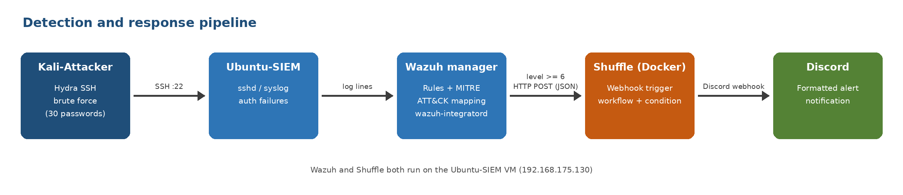

## What it does

1. Hydra (Kali) makes repeated SSH login attempts against the Ubuntu VM.
2. The Wazuh manager reads the failed logins from the VM's own logs and raises alerts, mapped to MITRE ATT&CK.
3. The Wazuh integrator forwards alerts of level 6 and above to a Shuffle webhook as JSON.
4. A Shuffle workflow runs for each alert and posts a formatted message to Discord.

## Lab architecture

| Machine | OS | Role |
| --- | --- | --- |
| Ubuntu-SIEM (192.168.175.130) | Ubuntu Server 24.04 | Wazuh 4.7.5 all-in-one (indexer, manager, dashboard) and Shuffle in Docker |
| Kali-Attacker | Kali Linux | Attack simulation with Hydra |

Both run in VMware Workstation on an isolated NAT network (192.168.175.0/24). Shuffle shares the Wazuh VM because host memory is limited.

## Tools

- Wazuh 4.7.5 (SIEM)
- Shuffle (SOAR), deployed with Docker Compose: backend, frontend, OpenSearch, orborus and a security container
- Hydra (attack simulation)
- Discord webhook (notification target)

## Implementation

### Shuffle
Shuffle runs as five containers. Its OpenSearch is published on host port 9201 so it does not clash with the Wazuh indexer on 9200.

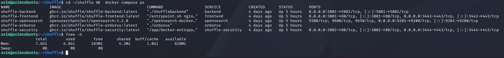

### Workflow
A webhook trigger feeds a Discord action through a condition.

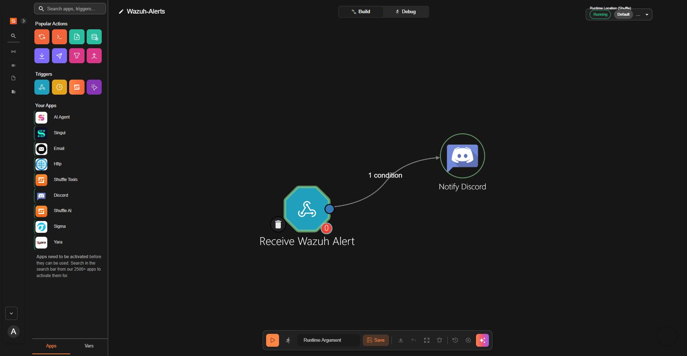

### Wazuh integration
An `<integration>` block in `ossec.conf` sends alerts of level 6 or higher to the Shuffle webhook in JSON format (webhook ID redacted).
The sanitized snippet is in [`configs/ossec-integration.xml`](configs/ossec-integration.xml).

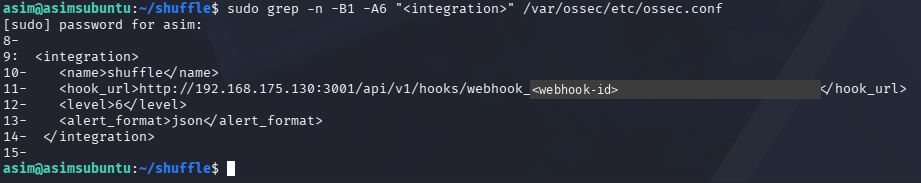

## Test: SSH brute force

```bash
hydra -l <user> -P /tmp/short-list-30.txt ssh://192.168.175.130 -t 4
```

30 password attempts; no valid password is found, which is expected, because the aim is detection.

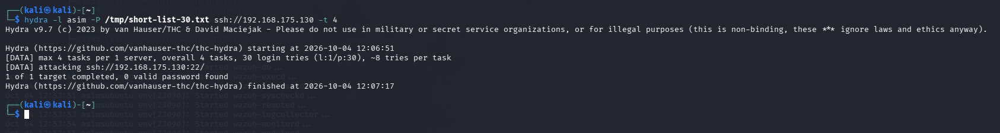

### Detection in Wazuh
The failures are logged on the Wazuh manager's own host, so they appear under agent 000. In a 40-minute window the dashboard showed 85 alerts, 56 of them authentication failures.

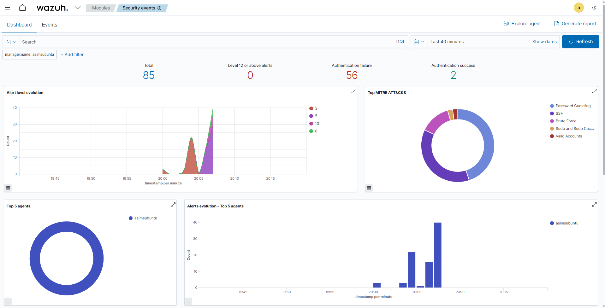

| Rule | Level | Description | MITRE ATT&CK |
| --- | --- | --- | --- |
| 5760 | 5 | sshd: authentication failed | T1110.001 Password Guessing, T1021.004 SSH |
| 2502 | 10 | syslog: User missed the password more than one time | T1110 Brute Force |

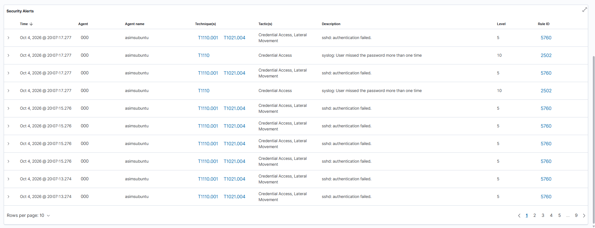

### Forwarding to Shuffle
Alerts below level 6 (such as the individual rule 5760 events) are not forwarded. The integrator log shows each alert being handed to Shuffle.

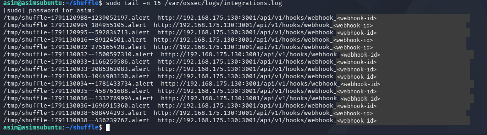

### Received in Shuffle
Each forwarded alert started a workflow run. The payload carries the title, rule ID, timestamp, the original log line and the full Wazuh alert.

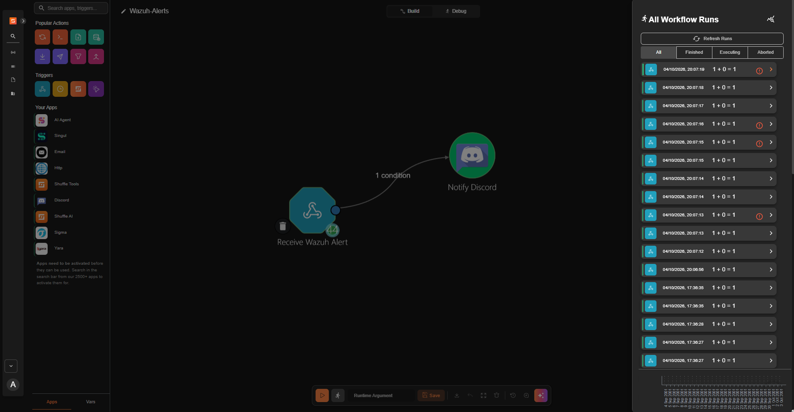
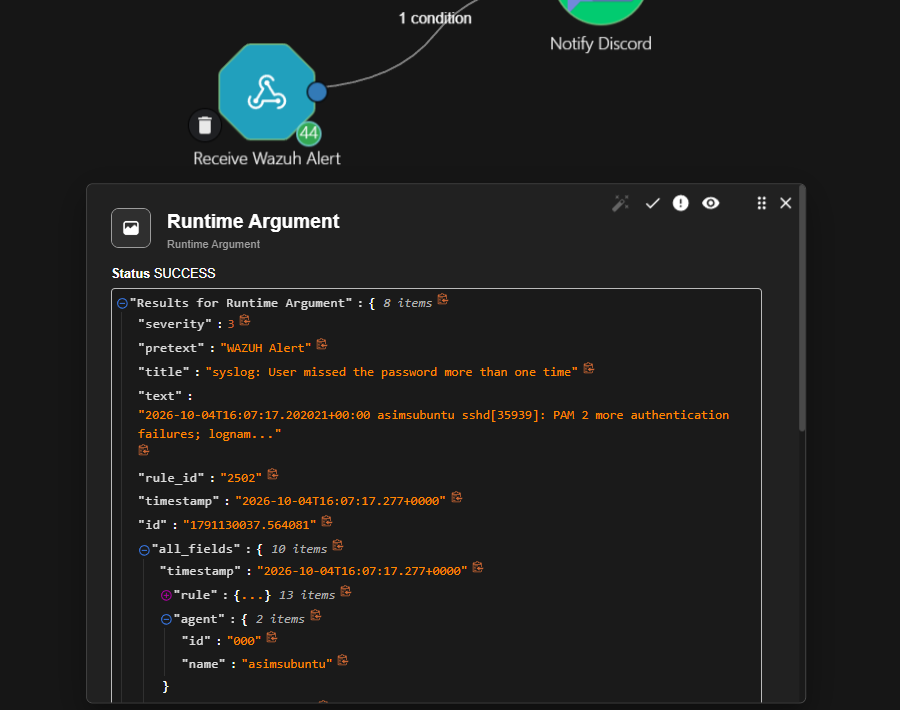

### Notification
Discord accepted the post (HTTP 204, `success: true`; webhook URL redacted), and the alert arrived as a formatted message.

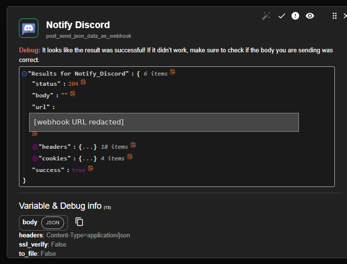
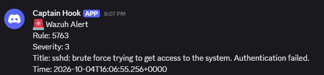

## Key findings

- Wazuh maps the SSH brute force to MITRE ATT&CK techniques without any extra rule writing.
- The `level` setting in the integration block controls the volume: at level 3 almost every event reached Shuffle, at level 6 only the higher-severity alerts did.
- The severity field in the Shuffle payload (3) is not the Wazuh rule level (10 for rule 2502), so use the rule ID when filtering.
- Running two OpenSearch-based tools (Wazuh's indexer and Shuffle's database) on one small VM needs explicit memory limits.

## Problems solved

Port 9200 clash, out-of-memory kills, an invalid `ossec.conf` that stopped the manager, and lab VM issues. Details with screenshots are in [`docs/troubleshooting.md`](docs/troubleshooting.md).

## Limitations and next steps

- Shuffle and Wazuh share one VM with little spare memory. A real deployment would separate them.
- Some runs in the Shuffle run list carry a warning icon that I did not investigate. Discord's webhook rate limit (5 requests per window in the response headers) is one possible cause.
- Next: a response action (block the source IP with Wazuh active response), alert throttling, threat-intelligence enrichment, and ticket creation.

## Repository layout

```
configs/      sanitized Wazuh integration block, Shuffle compose changes, Discord message body
docs/         setup guide and troubleshooting log
screenshots/  evidence, with webhook IDs and URLs redacted
```

## Disclaimer

Built and tested in an isolated lab on systems I own. Do not run these attacks against systems you do not have permission to test.
