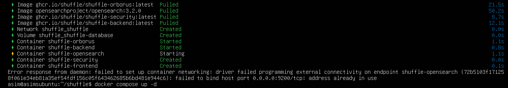
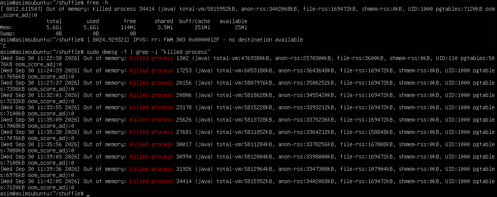
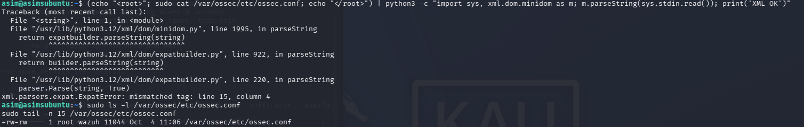

# Troubleshooting log

Problems hit while building this lab, with the cause and the fix.

## 1. Shuffle's OpenSearch would not start: port 9200 already in use

**Cause:** the Wazuh indexer already listens on 9200, and Shuffle's bundled OpenSearch publishes the same host port.
**Fix:** publish Shuffle's OpenSearch on 9201 (`9201:9200`) in `docker-compose.yml`.

## 2. Repeated out-of-memory kills, and the Wazuh indexer went down

**Cause:** two OpenSearch instances on one VM with no swap. Wazuh's indexer used a ~1.9 GB heap and Shuffle's default heap was 3 GB.
Orphaned Shuffle app containers (left behind after `docker compose down`) used more memory.
**Fix:** raise the VM to 8 GB, reduce Shuffle's OpenSearch heap to 1 GB, remove the orphaned containers
(`docker stop $(docker ps -q)` then `docker rm $(docker ps -aq)`, run on a dedicated lab VM only), and restart `wazuh-indexer`.

## 3. `wazuh-manager` would not restart after adding the integration block

**Symptom:** `Error reading XML file 'etc/ossec.conf': (line 0)` in `/var/ossec/logs/ossec.log`.
**Cause:** the `<hook_url>` element was not closed, so `ossec.conf` was invalid XML.
**Fix:** a Python XML parser pinpointed the mismatched tag, which Wazuh's own message could not do. After closing the element,
the XML check and `wazuh-analysisd -t` passed and the manager started. Validate before every restart.

## 4. Lab infrastructure issues

- A VM stored in OneDrive lost its virtual disk (the file was truncated while syncing). It was rebuilt from the official image,
  and the VM folders were moved to local storage outside OneDrive.
- A freshly imported VM had no IP address because the VMware DHCP and NAT services on the Windows host were stopped.
  Starting them and re-running `nmcli connection up` fixed it.
- Kali ships `rockyou.txt` compressed; run `gunzip` once before using it.
